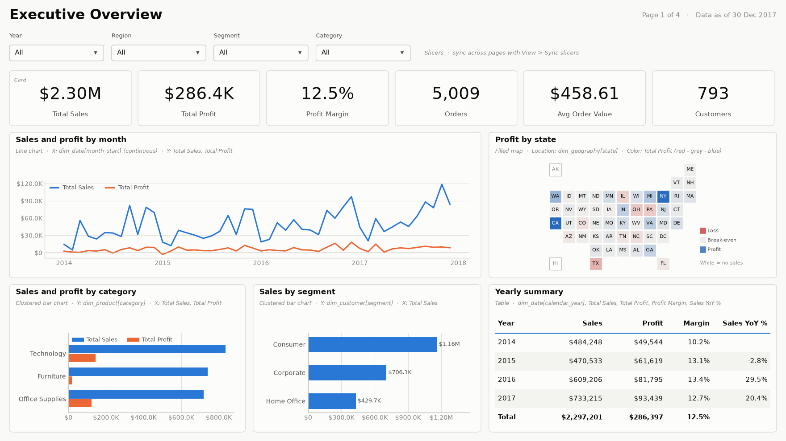
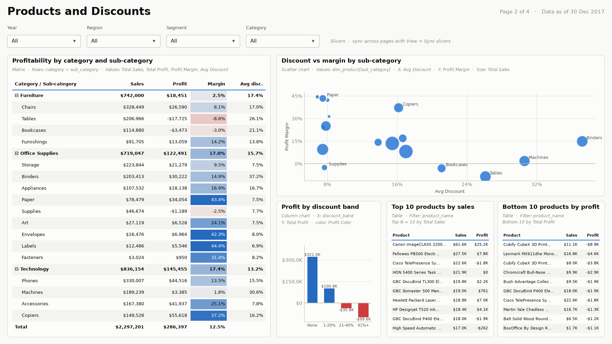
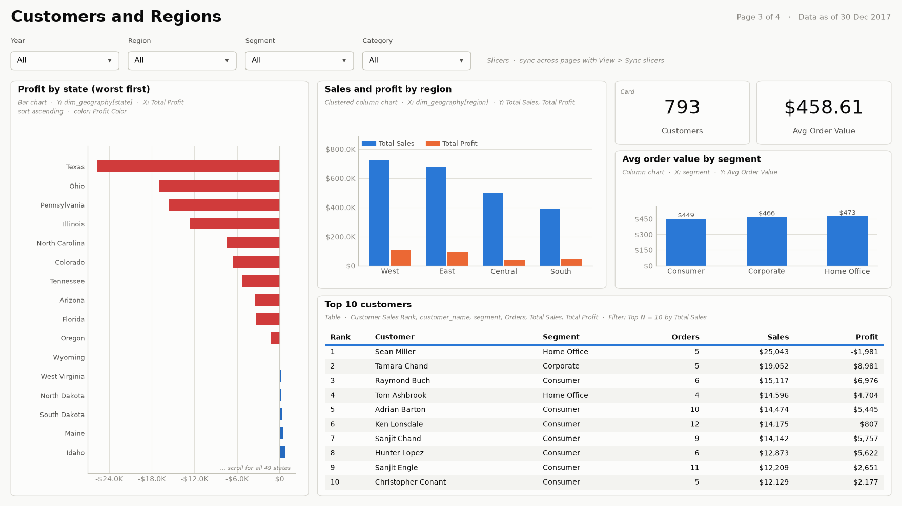
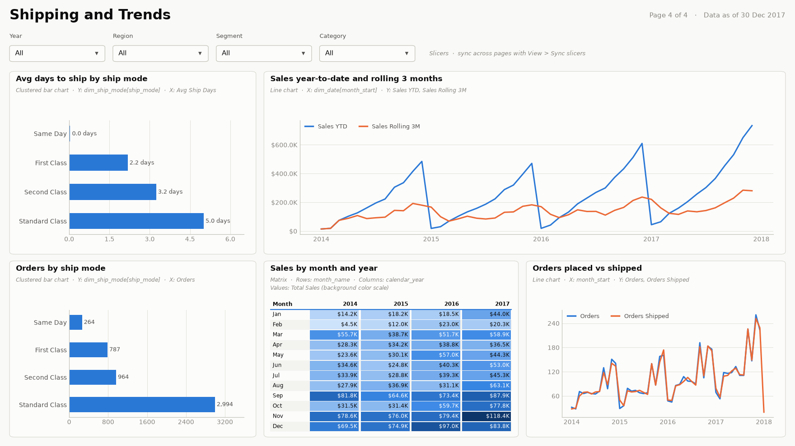

# Power BI Dashboard Build Guide

This guide builds the dashboard in Power BI Desktop on top of the
`reporting` schema in PostgreSQL. It takes about 1 to 2 hours.

Prerequisites:

- The pipeline has run successfully (`docker compose exec spark python src/run_pipeline.py`).
- The containers are running (`docker compose ps` shows `retail_postgres` as healthy).
- Power BI Desktop is installed (Microsoft Store version is fine).

Files used: [`powerbi/measures.dax`](../powerbi/measures.dax) and
[`powerbi/retail_theme.json`](../powerbi/retail_theme.json).

---

## 1. Connect to PostgreSQL

1. Open Power BI Desktop and choose **Get data > More... > Database > PostgreSQL database**.
2. Enter:
   - **Server:** `localhost:5432`
   - **Database:** `retail_analytics`
   - **Data Connectivity mode:** Import
3. Choose **Database** credentials (not Windows):
   - **User name:** `powerbi_reader` if you set `POWERBI_PASSWORD` in `.env`, otherwise `retail_user`.
   - **Password:** the matching password from your `.env` file.
4. If Power BI says it cannot connect with an encrypted connection, click
   **OK** to connect unencrypted. The database only listens on your own
   machine (`127.0.0.1`), so this is safe for local development.

## 2. Select tables

In the Navigator, expand `reporting` and tick only these six views:

- `reporting.fact_sales`
- `reporting.dim_date`
- `reporting.dim_customer`
- `reporting.dim_product`
- `reporting.dim_geography`
- `reporting.dim_ship_mode`

Do not select the `v_*` views (those are pre-aggregated summaries for SQL
analysis and would duplicate the measures) or anything in `analytics`.

Click **Transform Data**, then rename each query by removing the
`reporting ` prefix, so the names are `fact_sales`, `dim_date`,
`dim_customer`, `dim_product`, `dim_geography` and `dim_ship_mode`. The
DAX measures depend on these names. Click **Close & Apply**.

## 3. Build the model

Open **Model view**. Delete any relationships Power BI detected
automatically, then create these (Many to one, single cross-filter
direction, from `fact_sales` to the dimension):

| From (fact_sales) | To | Active |
| --- | --- | --- |
| `order_date_key` | `dim_date[date_key]` | Yes |
| `ship_date_key` | `dim_date[date_key]` | **No** (inactive) |
| `customer_key` | `dim_customer[customer_key]` | Yes |
| `product_key` | `dim_product[product_key]` | Yes |
| `geography_key` | `dim_geography[geography_key]` | Yes |
| `ship_mode_key` | `dim_ship_mode[ship_mode_key]` | Yes |

Then:

1. **Mark the date table:** select `dim_date`, then **Table tools > Mark as
   date table**, and pick `full_date`. The calendar has no gaps
   (2014-01-01 to 2018-12-31), so validation will pass.
2. **Turn off auto date/time:** **File > Options and settings > Options >
   Current file > Data load**, untick **Auto date/time**.
3. **Sort columns** (select the column, then **Column tools > Sort by column**):

   | Column | Sort by |
   | --- | --- |
   | `dim_date[month_name]` | `month_number` |
   | `dim_date[month_short]` | `month_number` |
   | `dim_date[day_name]` | `day_of_week` |
   | `dim_ship_mode[ship_mode]` | `ship_mode_sort` |
   | `fact_sales[discount_band]` | `discount_band_sort` |

4. **Data categories** (Column tools > Data category), for maps:
   `dim_geography[state]` = State or Province, `city` = City,
   `postal_code` = Postal code, `country` = Country.
5. **Hide technical columns** (right-click > Hide in report view): all
   `*_key` columns, `row_id`, `*_sort` columns, `date_key`.
6. **Formats:** set `sales`, `profit`, `list_sales` and `discount_amount`
   to Currency, and `discount` to Percentage.

## 4. Add measures

1. **Home > Enter data**, name the table `_Measures`, click **Load**.
2. Select `_Measures`, then add each measure from
   [`powerbi/measures.dax`](../powerbi/measures.dax) with **Modeling > New
   measure** (paste one measure at a time, starting with the measure name).
3. Delete the placeholder `Column1` in `_Measures`. The table moves to the
   top of the field list with a calculator icon.
4. Formats: Currency with 0 decimals for sales and profit measures;
   Percentage with 1 decimal for `Profit Margin`, `Avg Discount`,
   `Loss Lines %`, `Sales YoY %`, `Profit YoY %`; decimal with 1 place for
   `Avg Ship Days`.

## 5. Apply the theme

**Design > Themes** (click the down-arrow next to the theme thumbnails) **> Browse for themes**, then select `powerbi/retail_theme.json`. In older Power BI versions, Themes is on the **View** tab.

## 6. Build the report pages

Each page below has a mockup drawn from the real data, showing where each
visual goes. The grey italic line under each visual's title names the
visual type and the fields to drag in. Mockups are in
[`docs/images/mockups/`](images/mockups/).

Map and Filled map visuals are off by default. If they show a warning,
enable them in **File > Options and settings > Options > Global >
Security > Map and Filled Map visuals**, then restart Power BI Desktop.

Use a 16:9 page. On every page, put the same slicers in a strip at the top:
`dim_date[calendar_year]` (tile or dropdown), `dim_geography[region]`,
`dim_customer[segment]`, `dim_product[category]`. To keep slicer
selections across pages, use **View > Sync slicers**.

### Page 1: Executive Overview

| Visual | Fields |
| --- | --- |
| 6 Cards | `Total Sales`, `Total Profit`, `Profit Margin`, `Orders`, `Avg Order Value`, `Customers` |
| Line chart | X: `dim_date[month_start]` (set the X axis type to Continuous); Y: `Total Sales`, `Total Profit` (both in dollars, so one axis) |
| Clustered bar chart | Y: `dim_product[category]`; X: `Total Sales`, `Total Profit` |
| Filled map (or Shape map) | Location: `dim_geography[state]`; Color saturation: `Total Profit`. Format > Fill colors > Diverging: minimum `#D03B3B` (red), center `#F0EFEC` (grey) at 0, maximum `#256ABF` (blue) |
| Clustered bar chart | Y: `dim_customer[segment]`; X: `Total Sales` |
| Table (yearly summary) | `dim_date[calendar_year]`, `Total Sales`, `Total Profit`, `Profit Margin`, `Sales YoY %` |
| Text box or card (top right) | `Data As Of` |

`Sales YoY %` goes in the yearly table rather than a card: with no year
selected it compares all years against all years and is meaningless.

### Page 2: Products and Discounts

| Visual | Fields |
| --- | --- |
| Matrix | Rows: `category` > `sub_category`; Values: `Total Sales`, `Total Profit`, `Profit Margin`, `Avg Discount`. Conditional formatting: background color on `Profit Margin`, using the same diverging red, grey (at 0) and blue as the map |
| Scatter chart | Values: `dim_product[sub_category]`; X: `Avg Discount`; Y: `Profit Margin`; Size: `Total Sales` |
| Clustered column chart | X: `fact_sales[discount_band]`; Y: `Total Profit`; bar color by field value `Profit Color` |
| Table (Top 10) | `dim_product[product_name]`, `Total Sales`, `Total Profit`; filter pane: product_name Top N = 10 by `Total Sales` |
| Table (Bottom 10) | Same fields; Top N filter set to Bottom 10 by `Total Profit` |

The headline here is that every discount band above 20% has a negative margin.

### Page 3: Customers and Regions

| Visual | Fields |
| --- | --- |
| Clustered column chart | X: `dim_geography[region]`; Y: `Total Sales`, `Total Profit` |
| Bar chart | Y: `dim_geography[state]`; X: `Total Profit`; sort ascending to show the worst states first; color by `Profit Color` |
| Table | `dim_customer[customer_name]`, `segment`, `Orders`, `Total Sales`, `Total Profit`, `Customer Sales Rank`; Top N = 10 by `Total Sales` |
| Clustered column chart | X: `dim_customer[segment]`; Y: `Avg Order Value` |
| Cards | `Customers`, `Avg Order Value` |

### Page 4: Shipping and Trends

| Visual | Fields |
| --- | --- |
| Clustered bar chart | Y: `dim_ship_mode[ship_mode]`; X: `Avg Ship Days` |
| Clustered bar chart | Y: `dim_ship_mode[ship_mode]`; X: `Orders` |
| Line chart | X: `dim_date[month_start]`; Y: `Sales YTD`, `Sales Rolling 3M` |
| Matrix (heatmap) | Rows: `dim_date[month_name]`; Columns: `calendar_year`; Values: `Total Sales` with background color scale (shows the Q4 peak) |
| Line chart | X: `month_start`; Y: `Orders`, `Orders Shipped` |

## 7. Check the numbers

With no slicers selected, the cards must match the pipeline output and
[`reports/sales_insights.md`](../reports/sales_insights.md):

| Measure | Expected |
| --- | --- |
| Total Sales | $2,297,201 |
| Total Profit | $286,397 |
| Profit Margin | 12.5% |
| Orders | 5,009 |
| Customers | 793 |

In the yearly summary table on page 1, the 2017 row should show a Sales YoY % of 20.4%.

## 8. Save and export

1. Save as `powerbi/Retail_Sales_Dashboard.pbix`.
2. Take a screenshot of each page and save them in `docs/images/`
   (for example `01_executive_overview.png`); the README links to them.
3. Optional: **File > Export > Export to PDF** and save it as
   `reports/Retail_Sales_Dashboard.pdf`.
4. Optional: **Publish** to the Power BI Service. A scheduled refresh
   from the Service to this local database needs an on-premises data gateway;
   without one, refresh manually from Desktop.

## Refreshing after a pipeline run

Re-run the pipeline, then click **Home > Refresh** in Power BI Desktop.
The reporting views are dropped and recreated on each run, but their
names and columns stay the same, so the report keeps working.
